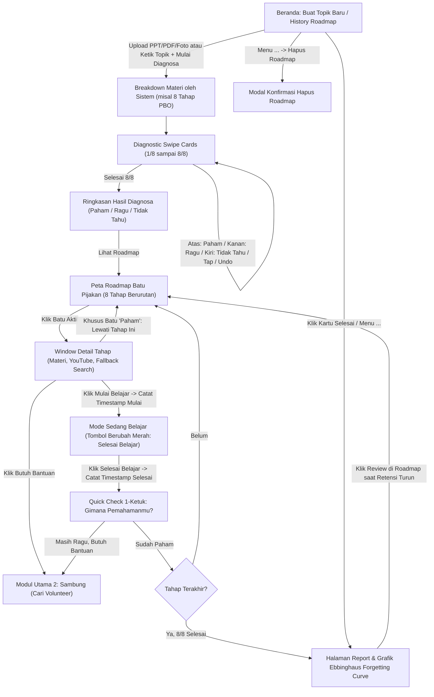

# Spesifikasi Fitur: Modul Utama 1 (Beranda / Diagnostic Roadmap & Ebbinghaus Report)

Dokumen ini adalah spesifikasi produk dan UX resmi untuk **Modul Utama 1 (Beranda)** pada proyek **Hoppa (UI/UX SEVENT X)**. Disusun agar mudah dibaca oleh tim maupun AI kolaborator sehingga desain UI, prototype Figma, dan integrasi dengan Modul Utama 2 (`Sambung`) tetap 100% selaras.

- **Proyek**: Hoppa (Mobile EdTech untuk Mahasiswa Indonesia)
- **Referensi Design System**: [DESIGN.md](./DESIGN.md)
- **Figma File**: `Hoppa - UI UX SEVENT X` (`fileKey: yGgze90aHFtpCw9LunI4Cl`)
- **Referensi Visual di Figma (`Page: Ide` `6:24`)**:
  - `image 13` (`517:2480`): Referensi visual jalur batu pijakan (*winding stepping-stone roadmap*)
  - `image 14` (`524:2483`): Referensi visual grafik **Ebbinghaus Forgetting Curve** pada halaman Report
- **Contoh Kasus Utama (Persona)**: **Raka Permana** (Mahasiswa Sistem Informasi, Semester 4, Institut Teknologi PLN) mempelajari topik **Pemrograman Berorientasi Objek (PBO)**.
- **Status**: Selesai diimplementasikan di Figma (`Big Design` -> Section `Homepage (Modul 1: Diagnosa & Roadmap)` `531:1982`, 23 layar `440x956`, 103 reaksi prototype aktif, Flow Starting Point **`Hoppa Modul 1 Flow`** pada `533:1975`).

---

## 1. Tujuan & Nilai Utama Modul 1

Membantu mahasiswa menambal celah dasar materi kuliah (*learning gap*) secara terstruktur langkah demi langkah (**"Hop over the gap"**), mulai dari:
1. Memecah bahan kuliah mentah (PPT, PDF, modul, atau foto soal) menjadi konsep-konsep kecil yang berurutan.
2. Mendiagnosa tingkat pemahaman awal secara cepat dan jujur lewat kartu geser (*swipe cards*) berisi contoh nyata.
3. Menyusun jalur belajar berurutan (*stepping-stone roadmap*) dengan aturan kontrol yang seimbang antara disiplin fondasi dan kebebasan pengguna.
4. Menjaga pemahaman tetap melekat jangka panjang menggunakan **Kurva Pelupaan Ebbinghaus** dan siklus review berbasis *timestamp*.

---

## 2. Alur Pengguna End-to-End



---

## 3. Spesifikasi Fungsional per Bagian

### 3.1 Beranda (Hub Topik, Create, History & Delete Roadmap)
1. **Header & Kartu Aksi Utama**:
   - Sapaan personal: `"Hai Raka!"` + `"Mau mendalami materi apa hari ini?"`.
   - Input topik + tombol **`Upload`** untuk mengunggah bahan kuliah (format: **PPT/PPTX, PDF, modul, atau foto soal**).
   - CTA utama: **`Mulai Diagnosa`**.
2. **Empty State (Pengguna Baru)**:
   - Ditampilkan saat Raka belum memiliki roadmap apa pun (misal baru selesai Onboarding).
   - Menampilkan maskot Hoppa + penjelasan jujur + ajakan upload/ketik materi pertama.
3. **Daftar History Roadmap (Active & Completed State)**:
   - Filter ringkas di atas daftar: **`Semua`** | **`Berjalan`** | **`Selesai`**.
   - **Kartu Roadmap Berjalan**: menampilkan judul topik (misal *Pemrograman Berorientasi Objek*), progres tahap (misal `3/8 tahap`), dan aksi langsung `Lanjut Belajar`.
   - **Kartu Roadmap Selesai**: menampilkan status **Retensi Ebbinghaus** terkini:
     - Retensi aman (`>= 60%`): badge hijau lembut (misal `92% • Terjaga`).
     - Retensi rawan (`< 60%`): badge merah lembut (misal `58% • Perlu Review!`) untuk mendorong review segera.
4. **Menu Aksi & Hapus Roadmap**:
   - Setiap kartu memiliki tombol menu titik tiga (**`...`**) dengan opsi **Lihat Report** dan **Hapus Roadmap**.
   - Memilih **Hapus Roadmap** wajib membuka **Modal Konfirmasi Hapus** untuk mencegah kehilangan progres akibat ketukan tidak sengaja.

---

### 3.2 Breakdown Materi & Diagnostic Swipe Cards
1. **Pemecahan Materi Otomatis**:
   - Sistem membaca file/topik yang diunggah (contoh: materi *Pemrograman Berorientasi Objek*) lalu menyusun daftar tahapan belajar secara berurutan dari fondasi ke lanjutan (misal 8 tahapan: *1. Class & Object*, *2. Constructor*, *3. Encapsulation*, *4. Access Modifier*, *5. Inheritance*, *6. Polymorphism*, *7. Abstract Class*, *8. Interface*).
2. **Anatomi Kartu Diagnosa (Tinder-style)**:
   - Progress counter di atas kartu (`1/8` sampai `8/8`).
   - **Judul materi/konsep** (contoh: `Class & Object`).
   - **Penjelasan singkat** (1-2 kalimat padat agar cepat dipindai).
   - **Contoh konkret sesuai jurusan**:
     - Jurusan IT / Sistem Informasi: potongan kode singkat (*code snippet*).
     - Jurusan lain (misal Elektro, Teknik, Ekonomi): gambar diagram, contoh soal, atau studi kasus mini.
   - Tujuannya agar mahasiswa benar-benar mengenali materi yang dimaksud sebelum menilai dirinya sendiri.
3. **Interaksi Kartu (Gestur + Aksesibilitas)**:
   - **Swipe Atas** = **Paham** (aksen hijau).
   - **Swipe Kanan** = **Ragu** (aksen kuning/amber).
   - **Swipe Kiri** = **Tidak Tahu Sama Sekali** (aksen merah).
   - **3 Tombol Tap Alternatif** di bawah kartu (`Tidak Tahu`, `Paham`, `Ragu`) agar nyaman dipakai satu tangan dan ramah aksesibilitas.
   - **Tombol Undo** untuk mengembalikan kartu terakhir jika pengguna salah geser.
4. **Layar Ringkasan Diagnosa**:
   - Muncul setelah kartu terakhir (`8/8`) selesai digeser.
   - Merangkum komposisi awal (contoh: `2 Paham • 3 Ragu • 3 Tidak Tahu`) beserta estimasi peta belajar, lalu tombol CTA menuju **Peta Roadmap**.

---

### 3.3 Winding Stepping-Stone Roadmap (`image 13`)
1. **Struktur Jalur**:
   - Seluruh tahapan (misal 8 batu) ditampilkan lengkap secara berurutan pada jalur berkelok (referensi visual `image 13`), ditemani maskot buaya Hoppa pada posisi tahapan aktif.
   - Setiap batu menampilkan label/indikator status diagnosa awal (`Paham`, `Ragu`, atau `Tidak Tahu`) dan status penyelesaian (`Selesai`, `Aktif`, `Terkunci`).
2. **Aturan Penguncian & Kontrol Pengguna (Prerequisite Gating + User Freedom)**:
   - Tahapan di depan tetap **terkunci** (tidak bisa langsung melompat ke batu jauh di depan) agar fondasi materi tetap runtut.
   - **Khusus batu berstatus `Paham`**: memiliki tombol **`Lewati Tahap Ini (Skip)`** di dalam window detailnya. Pengguna bebas memilih tetap mengulas materi tersebut atau langsung melewati ke tahapan berikutnya.
   - **Batu berstatus `Ragu` dan `Tidak Tahu`**: **tidak memiliki tombol skip**; pengguna wajib menyelesaikan proses belajar pada tahap ini terlebih dahulu sebelum batu berikutnya terbuka.

---

### 3.4 Window / Bottom Sheet Detail Tahap
Saat batu aktif (atau batu yang sudah selesai untuk review) diklik, terbuka window detail tahap berisi:
1. **Informasi Tahap**: Nomor & judul tahapan (misal `Tahap 3: Encapsulation`), badge hasil diagnosa, ringkasan 1-2 kalimat, dan contoh kode/studi kasus.
2. **Rekomendasi Belajar**:
   - Daftar rekomendasi link video **YouTube** yang relevan dengan tahapan tersebut.
   - **Fallback Search Engine** (tombol pencarian cepat ke Google/web) jika link video tidak memadai atau pengguna ingin mencari referensi bacaan tambahan.
3. **Alur Tombol Aksi & Pencatatan Timestamp**:
   - **State Awal (Belum Mulai)**:
     - Tombol utama: **`Mulai Belajar`** (saat diklik, sistem mencatat **`timestamp_mulai`** dan menampilkan status/durasi belajar aktif).
     - Tombol sekunder: **`Butuh Bantuan`** (mengarahkan ke Modul Utama 2 **`Sambung`**).
     - Tombol khusus batu `Paham`: **`Lewati Tahap Ini`**.
   - **State Sedang Belajar**:
     - Menampilkan penanda waktu mulai & durasi berjalan.
     - Tombol utama berubah menjadi tombol berwarna **merah (`Destructive/Danger`)** bertuliskan **`Selesai Belajar`**.
   - **State Penyelesaian (Quick Check 1-Ketuk)**:
     - Saat **`Selesai Belajar`** diklik, sistem mencatat **`timestamp_selesai`** (dan menghitung durasi belajar), lalu menampilkan konfirmasi 1-ketuk: *"Gimana pemahamanmu sekarang?"*
       - **`Sudah Paham`** -> tahap ditandai selesai, progress tersimpan, dan batu berikutnya terbuka (atau masuk ke halaman **Report** jika ini tahap terakhir).
       - **`Masih Ragu, Butuh Bantuan`** -> langsung diarahkan ke Modul Utama 2 (**`Sambung`**) membawa konteks topik & tahapan ini.

---

### 3.5 Halaman Report & Kurva Retensi Ebbinghaus (`image 14`)
Terbuka otomatis setelah tahap terakhir selesai, serta dapat diakses kapan saja dari History Roadmap di Beranda:
1. **Grafik Utama: Ebbinghaus Forgetting Curve (`image 14`)**:
   - **Sumbu Y**: Persentase retensi pemahaman (`0%` sampai `100%`), dilengkapi garis batas peringatan pada **`60%`**.
   - **Sumbu X**: Waktu berlalu (Hari ke-0, 1, 3, 6, dst.).
   - **Perilaku Kurva**:
     - Setelah selesai belajar di Hari ke-0 (`100%`), persentase retensi menurun bertahap bila pengguna tidak berlatih/me-review topik tersebut (hingga turun ke zona `< 60%`).
     - Setiap kali pengguna melakukan review materi pada topik ini, kurva melonjak kembali ke **`100%`** dan kemiringan penurunannya makin landai (*spaced repetition effect*).
2. **Ringkasan Metrik Jujur**:
   - Retensi saat ini (`%`) & status (`Terjaga` / `Perlu Review`).
   - Total waktu belajar (akumulasi nyata dari `timestamp_selesai - timestamp_mulai` tiap tahap).
   - Jumlah sesi review & rekomendasi jadwal review berikutnya.
3. **Mekanisme Review**:
   - CTA **`Review di Roadmap`**: membuka kembali Peta Roadmap topik tersebut agar pengguna dapat mengklik ulang batu materi, membaca/menonton referensi, dan menyelesaikan sesi review (mencatat timestamp review baru) sehingga grafik Ebbinghaus otomatis naik kembali ke **`100%`**.

---

## 4. Model Data Konseptual (Untuk Kolaborasi Tim & Integrasi Modul 2)

```json
{
  "roadmap": {
    "id": "rm_pbo_01",
    "topicTitle": "Pemrograman Berorientasi Objek",
    "sourceType": "ppt | pdf | image | manual_text",
    "sourceFileName": "Pertemuan_3_PBO_SI.pptx",
    "status": "in_progress | completed",
    "createdAt": "2026-11-26T19:00:00+07:00",
    "retentionScore": 78,
    "lastReviewedAt": "2026-11-28T20:15:00+07:00",
    "totalStudyMinutes": 115,
    "steps": [
      {
        "order": 1,
        "title": "Class & Object",
        "summary": "Class adalah cetak biru (blueprint), sedangkan Object adalah wujud nyata yang dibuat dari class tersebut.",
        "exampleType": "code | diagram | case_study",
        "exampleContent": "class Mahasiswa {\n  String nama;\n  void belajar() { ... }\n}",
        "diagnosis": "understood | unsure | unknown",
        "canSkip": true,
        "state": "completed | skipped | active | locked",
        "youtubeLinks": [
          { "title": "Konsep Class & Object dalam 8 Menit", "url": "https://..." }
        ],
        "fallbackSearchQuery": "materi class dan object pemrograman berorientasi objek",
        "sessions": [
          {
            "type": "initial | review",
            "startedAt": "2026-11-26T19:20:00+07:00",
            "completedAt": "2026-11-26T19:42:00+07:00",
            "postCheck": "understood | need_help"
          }
        ]
      }
    ],
    "retentionHistory": [
      { "day": 0, "retention": 100, "event": "first_learned" },
      { "day": 1, "retention": 80, "event": "decay" },
      { "day": 1, "retention": 100, "event": "reviewed" },
      { "day": 3, "retention": 78, "event": "decay" }
    ]
  }
}
```

---

## 5. Titik Integrasi ke Modul Utama 2 (`Sambung`)

Modul 1 terhubung langsung ke Modul 2 (`Sambung`) pada 2 titik pemicu:
1. Tombol **`Butuh Bantuan`** di dalam Window Detail Tahap Roadmap.
2. Pilihan **`Masih Ragu, Butuh Bantuan`** pada Quick Check 1-ketuk setelah klik `Selesai Belajar`.

**Konteks yang diteruskan ke Modul 2 (`Sambung`)**:
- `roadmapId` & `topicTitle` (contoh: `Pemrograman Berorientasi Objek`)
- `stepOrder` & `stepTitle` (contoh: `Tahap 3: Encapsulation`)
- `diagnosis` & `studyDurationMinutes` (agar volunteer langsung paham posisi kebingungan pengguna tanpa pengguna harus menjelaskan ulang dari awal)

*(Detail mekanisme Modul 2 `Sambung` akan didokumentasikan terpisah pada `MODUL_2_SAMBUNG.md`.)*

---

## 6. Landasan Teori Ilmiah & Prinsip UX (Material Pitch Deck SEVENT X)

| Keputusan Desain di Modul 1 | Landasan Teori / Riset | Dampak bagi Pengguna |
|---|---|---|
| Penjelasan 1-2 kalimat + contoh kode/soal di dalam Swipe Card | **Metacognitive Calibration & Anti *Illusion of Competence*** (Kruger & Dunning, 1999; Bjork, 1994) | Mencegah mahasiswa merasa paham hanya karena familier dengan judul bab; penilaian diri didasarkan pada contoh konkret. |
| Swipe 3 arah + 3 tombol tap alternatif + tombol Undo | **Shneiderman's 8 Golden Rules #6** (*Permit Easy Reversal of Actions*) + Motor Accessibility | Mengurangi kecemasan salah geser dan tetap nyaman digunakan dengan satu tangan. |
| Semua tahap tampil berurutan; tombol `Skip` hanya pada batu `Paham`, wajib pada `Ragu`/`Tidak Tahu` | **Shneiderman's 8 Golden Rules #7** (*Support Internal Locus of Control*) + **Mastery Learning** (Bloom, 1968) & **ZPD** (Vygotsky, 1978) | Menghormati kebebasan pengguna yang sudah paham sambil melindungi pemula dari *cognitive overload* akibat melompati fondasi. |
| Quick Check 1-ketuk -> jembatan langsung ke `Sambung` | **Metacognitive Monitoring & Social Constructivism** (Vygotsky, 1978) | Mengubah rasa buntu saat belajar mandiri menjadi aksi mencari pendamping sebaya secara instan. |
| Grafik Retensi + Review di Roadmap berbasis *timestamp* | **Ebbinghaus Forgetting Curve** (1885) & **Spaced Repetition** (Cepeda et al., 2006) | Mengukur pelupaan secara visual dan mendorong review berkala sebelum retensi jatuh di bawah 60%. |
| Menu titik tiga (`...`) + Modal Konfirmasi Hapus Roadmap | **Shneiderman's 8 Golden Rules #5** (*Offer Simple Error Handling / Prevention*) | Melindungi riwayat belajar dari penghapusan tidak sengaja. |

---

## 7. Standar UI & Teknis Saat Implementasi Nanti

Seluruh layar Modul 1 wajib mengikuti aturan baku di [DESIGN.md](./DESIGN.md):
- **Viewport & Sudut**: `440x956` (iPhone 16 Pro Max), corner radius **`48px`** dengan iOS squircle smoothing **`60%`**.
- **Auto Layout Layar**: Root screen `VERTICAL` Auto Layout (`FIXED 440x956`), `Main Body / Scroll Area` diset `FILL` vertikal, overlay (modal, bottom sheet, floating bottom nav) memakai `Absolute Position`.
- **Surface Strategy**: Daily work flow menggunakan kanvas terang `#F7F9FA` (`surface/canvas`) + card `#FFFFFF` (`surface/card`) + aksen header/progress brand.
- **Tipografi & Aksesibilitas**: `Nunito` (Heading, CTA, Chip, Badge) + `Plus Jakarta Sans` (Body, Form, Caption), kontras warna wajib lolos **WCAG AA (>= 4.5:1)**, tap target minimal `44px` (`48px` untuk CTA/input), tanpa em dash pada copywriting UI.
