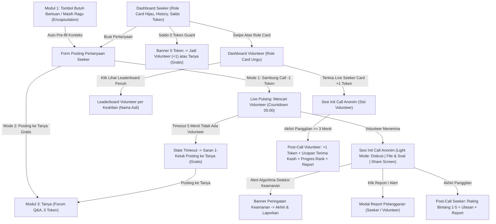

# Spesifikasi Fitur: Modul Utama 2 (Sambung / Dual-Role Anonim Seeker & Volunteer)

Dokumen ini adalah spesifikasi produk dan UX resmi untuk **Modul Utama 2 (`Sambung`)** pada proyek **Hoppa (UI/UX SEVENT X)**. Disusun agar mudah dibaca oleh anggota tim maupun AI kolaborator sehingga sinkron penuh dengan [DESIGN.md](./DESIGN.md), [MODUL_1_BERANDA.md](./MODUL_1_BERANDA.md), serta jembatan ke Modul 3 (`Tanya`).

- **Proyek**: Hoppa (Mobile EdTech untuk Mahasiswa Indonesia)
- **Referensi Design System**: [DESIGN.md](./DESIGN.md)
- **Referensi Modul Sebelumnya**: [MODUL_1_BERANDA.md](./MODUL_1_BERANDA.md)
- **Figma File**: `Hoppa - UI UX SEVENT X` (`fileKey: yGgze90aHFtpCw9LunI4Cl`)
- **Komponen Terkait (`Komponen` `5:22`)**:
  - `Role Card` (`450:1322`): Stacked swipe-up card untuk berpindah role `Seeker <-> Volunteer`
  - `Bottom Navigation` (`450:1149`): Tab `Sambung`
  - `Token Pill Badge` (`618:3024`): 4 varian (`Default`, `Cost`, `Reward`, `Empty`)
  - `Star Rating Input` (`618:3057`): 2 varian (`Empty`, `Rated`)
  - `Call Control Dock` (`618:3114`): 2 varian (`VoiceChanger=On`, `Off`)
  - `Leaderboard Row` (`618:3131`): 2 varian (`Highlight=False`, `True`)
  - `Live Seeker Card` (`618:3180`): 2 varian (`Match=Highlighted`, `Default`)
- **Contoh Kasus Utama (Persona)**: **Raka Permana** (Mahasiswa Sistem Informasi Sem 4, IT PLN; nama samaran di Sambung: **`Buaya Cipondoh`**; keahlian: `Analisis & Perancangan Sistem`, `Basis Data`, `UI/UX Design`; minat/hobi: `Formula 1`, `Sepak Bola`, `Marvel Cinematic`).
- **Status**: **Terimplementasi penuh di Figma** pada section **`Sambung (Modul 2: Seeker & Volunteer)`** (`623:2738` di halaman `Big Design` `5:23`), 17 layar termasuk **`01a. Seeker: Dashboard (Akun Baru)`** (`679:3444`), **`01b. Seeker: Dashboard & History`** (`623:2750`), **`03a. Seeker: Form Pertanyaan (Kosong)`** (`687:3805`), dan **`03b. Seeker: Form Pertanyaan (Auto Pre-fill)`** (`623:2969`), 5 komponen reusable baru, Flow Starting Point **`Hoppa Modul 2 Flow`** (`623:2750`), serta terhubung penuh dari Modul 1 (`Butuh Bantuan` & `Bottom Navigation`). Arsip desain lama tersimpan aman di **`Archive: Sambung Lama`** (`184:1090`).

---

## 1. Tujuan & Nilai Utama Modul 2

Menyediakan ruang bantuan belajar sebaya (*peer-to-peer live voice call*) yang **aman, anonim, dan saling menguntungkan** bagi mahasiswa yang mentok saat belajar mandiri:
1. Menghilangkan rasa malu bertanya (*social evaluation anxiety*) melalui **identitas anonim (`Buaya Cipondoh`) + Voice Changer**.
2. Menjaga keseimbangan komunitas lewat **Ekonomi Token Dual-Role**: satu akun berperan sebagai **Seeker** (`-1 Token` saat dibantu lewat Call) sekaligus **Volunteer** (`+1 Token` saat membantu teman sebaya).
3. Menumbuhkan kebanggaan akademik melalui **Leaderboard Volunteer per Keahlian** (menggunakan nama asli), sementara saat sesi Call tetap anonim dengan badge kredibilitas (misal **`#1 PBO • Institut Teknologi PLN`**).
4. Menjamin keamanan ruang panggilan anonim dengan **Algoritma Deteksi Kejahatan/Pelanggaran Real-Time**, batas sesi **60 menit**, dan **Report dua arah**.

---

## 2. User Story Berkesinambungan 3 Babak (Untuk Demo Juri & Naskah Video)

Cerita utuh dari awal hingga akhir agar juri langsung memahami kesinambungan seluruh fitur Hoppa:

- **Babak 1 (Auth -> Onboarding -> Modul 1 `Beranda`)**:
  Raka mendaftar dengan email kampus `@itpln.ac.id`, melengkapi Onboarding (`Sistem Informasi`, Sem 4, keahlian `APS / Basis Data / UI/UX Design`, hobi `Formula 1 / Sepak Bola / Marvel Cinematic`), lalu mengunggah PPT kuliah PBO. Setelah swipe `8/8` kartu diagnosa dan menapaki Roadmap (melewati Tahap #1 `Paham`, belajar Tahap #3 `Encapsulation`), Raka masih merasa ragu pada Quick Check dan menekan **`Masih Ragu, Butuh Bantuan`**.
- **Babak 2 (Modul 2 `Sambung` sebagai Seeker)**:
  Form pertanyaan Raka langsung **terisi otomatis** konteks *Tahap 3: Encapsulation* + opsi *Utamakan volunteer yang nyambung hobi*. Raka memilih **`Sambung (1-Tap Call • -1 Token)`**, masuk layar pencarian berdenyut (tersedia juga skenario demo **Timeout 5 Menit -> saran posting gratis ke `Tanya`**), lalu terhubung anonim sebagai **`Buaya Cipondoh`** dengan Volunteer **`Buaya Dago`** (`#1 PBO • Institut Teknologi PLN`, *Sama-sama suka Formula 1!*). Di sesi Call, mereka diskusi dengan **Voice Changer** & **Share Screen** (dilengkapi demo **Alert Deteksi Keamanan** & **Modal Report**). Setelah selesai, Raka memberi **Rating Bintang 5** (`Saldo Token: 3 -> 2 Token`).
- **Babak 3 (Modul 2 `Sambung` sebagai Volunteer)**:
  Raka menggeser **`Role Card`** ke atas untuk beralih ke mode **`Volunteer`**, melihat posisinya di **Leaderboard `UI/UX Design`** (menggunakan nama asli **Raka Permana**), lalu menerima panggilan live dari **`Buaya Kemang`** yang sedang bingung *Auto Layout di Figma*. Setelah membantu lewat sesi Call anonim, Raka menerima apresiasi **`+1 Token` (`2 -> 3 Token`)**, ucapan terima kasih, dan naik peringkat di Leaderboard `UI/UX Design`.

---

## 3. Alur Pengguna End-to-End



---

## 4. Kebijakan Identitas Anonim, Reputasi & Ekonomi Token

### 4.1 Aturan Anonimitas vs Nama Asli
| Area Tampilan | Identitas yang Ditampilkan | Tujuan |
|---|---|---|
| **Sesi Call, Live Queue, & History Sambung** | Nama samaran unik (contoh: `Buaya Cipondoh`, `Buaya Dago`, `Buaya Kemang`) + avatar maskot | Menjaga privasi dan menghilangkan rasa malu bertanya (*psychological safety*). |
| **Badge Kredibilitas Volunteer saat Call** | Peringkat & kampus terverifikasi tanpa nama asli (contoh: `#1 PBO • Institut Teknologi PLN`) + chip *ice-breaker* hobi (contoh: `Sama-sama suka Formula 1!`) | Membangun kepercayaan Seeker dan mencairkan suasana obrolan anonim. |
| **Leaderboard Volunteer (per Keahlian)** | **Nama asli** (contoh: `Raka Permana`), asal kampus, rating rata-rata, dan total mahasiswa terbantu | Memberikan kebanggaan reputasi (*social pride*) dan insentif membantu secara konsisten. |

### 4.2 Aturan Ekonomi Token
- **Saldo Awal**: Setiap pengguna baru otomatis mendapat **`3 Token`**.
- **Seeker (`-1 Token`)**: Dipotong saat panggilan Sambung berhasil tersambung dengan Volunteer.
- **Volunteer (`+1 Token`)**: Diberikan setelah sesi panggilan sah selesai (durasi minimal **3 menit** tanpa laporan pelanggaran valid).
- **Perlindungan & Refund Otomatis**:
  - Jika pencarian mencapai **timeout 5 menit** tanpa Volunteer -> **0 token terpotong**, disarankan posting gratis ke Modul 3 (`Tanya`).
  - Jika panggilan putus `< 1 menit` karena kendala jaringan -> **token Seeker tidak terpotong (aman)**.
- **Posting ke Modul 3 (`Tanya`)**: Selalu **Gratis (`0 Token`)**.
- **Guard Saldo `0 Token`**: Tombol `Sambung Call (-1 Token)` terkunci dengan banner jujur menawarkan 2 jalan keluar: **`Bantu Teman di Volunteer (+1 Token)`** atau **`Posting Gratis di Tanya`**.

---

## 5. Spesifikasi Fungsional per Alur

### 5.1 Dashboard Role Seeker
- **`Role Card` (`Seeker` hijau)**: Menampilkan nama samaran `Buaya Cipondoh`, kampus `Institut Teknologi PLN`, dan petunjuk *"Swipe ke atas untuk ganti ke Volunteer"* (saldo **`3 Token`** ditempatkan di kanan sejajar judul **`Sambung`** pada header biru).
- **Kartu Utama "Butuh Bantuan Belajar?"**: CTA **`Buat Pertanyaan Baru`** (atau banner guard jika `0 Token`).
- **History Sesi Sambung**: Daftar riwayat sesi Seeker memuat judul pertanyaan, bidang keahlian, nama samaran volunteer (`Buaya Dago`), durasi menit (`22 menit`), status (`Selesai` / `Dialihkan ke Tanya`), dan rating yang diberikan.

### 5.2 Form Posting Pertanyaan Seeker
- **Field Utama**:
  1. **Judul Pertanyaan** (contoh auto pre-fill dari Modul 1: `Bingung konsep Encapsulation & Getter Setter`).
  2. **Deskripsi / Penjelasan Pertanyaan** (detail bagian yang membingungkan).
  3. **Attach File Pertanyaan** (PPT, PDF, cuplikan kode, atau foto soal; otomatis melampirkan cuplikan *Tahap 3 PBO* bila datang dari Modul 1).
  4. **Bidang / Mata Kuliah Keahlian** (dropdown/chip: `Pemrograman Berorientasi Objek`, `Basis Data`, `UI/UX Design`, dll.).
  5. **Toggle Opsional**: **`Utamakan volunteer yang nyambung hobi`** (memanfaatkan data minat/hobi Onboarding seperti `Formula 1`, `Sepak Bola`, `Marvel Cinematic`).
- **2 Pilihan Mode Bantuan saat Posting** (pada `03b` <-> `03c`):
  1. **`1-Tap Call (-1 Token)` (`03b`)**: CTA **`Cari Volunteer (-1 Token)`** masuk ke `04a. Live Mencari Volunteer (PBO)`.
  2. **`Forum Tanya (Gratis)` (`03c`)**: CTA berubah menjadi **`Posting ke Tanya (Gratis)`** dan langsung mengirim pertanyaan ke **`05. Tanya: Timeline (Postingan Terkirim)`** (`942:4580`) lengkap dengan notifikasi snackbar melayang `Pertanyaanmu diposting`.

### 5.3 Live Pulsing Matching & Timeout 5 Menit
- **State Mencari (`Finding Volunteer`)**: Animasi lingkaran denyut (*pulsing radar*) di sekitar avatar `Buaya Cipondoh`, status live *"Mencari Volunteer ahli PBO..."*, **countdown `05:00`**, kartu ringkasan pertanyaan yang sedang dicari, info `Token baru terpotong saat tersambung`, dan tombol **`Batalkan Pencarian`**.
- **State Timeout (`5 Menit Habis`)**: Tampil bila 5 menit tidak ada Volunteer yang mengambil sesi. Menginformasikan token aman tidak terpotong, dengan CTA utama **`Posting ke Tanya (Gratis)`** (1-ketuk membawa seluruh isi form tanpa ketik ulang) dan tombol sekunder **`Coba Cari Lagi`**.

### 5.4 Sesi Inti Call Anonim (Light Mode Bersih + 4 State Demo)
Menggunakan antarmuka terang bersih khas Hoppa (`#F7F9FA` canvas + card putih `#FFFFFF` + blok kode gelap `#1C2833` pada Share Screen) agar konsisten di seluruh aplikasi dan nyaman dibaca saat diskusi:
- **Header Call**: Badge **`Deteksi Keamanan Aktif`** (hijau lembut), **Timer sesi berjalan** dengan indikator batas **`maks 60:00`**, dan tombol **`Report`** di pojok kanan atas.
- **Tab Switch Tengah**: **`Diskusi Audio`** | **`File & Soal`** | **`Share Screen`**.
- **Bar Kontrol Bawah (`Call Control Dock`)**:
  - `Mute` (toggle mikrofon)
  - `Speaker` (toggle output suara)
  - **`Voice Changer`** (toggle aktif penyamar suara agar identitas suara 100% terjaga)
  - **`Share Screen`** (berbagi layar materi/kode)
  - Tombol merah **`Akhiri Panggilan`**
- **4 State Demo Kunci untuk Presentasi & Video**:
  1. **Sesi Call Normal (`Diskusi Audio`)**: Avatar `Buaya Cipondoh` (Seeker) & `Buaya Dago` (Volunteer) dengan badge **`#1 PBO • Institut Teknologi PLN`**, chip *ice-breaker* **`Sama-sama suka Formula 1!`**, indikator **`Voice Changer Aktif`**, dan kartu ringkas judul pertanyaan.
  2. **Mode `Share Screen` / `File & Soal`**: Menampilkan pratinjau layar/file lampiran Seeker (`Nilai.java` / slide Encapsulation) beserta judul & deskripsi lengkap, dengan indikator speaker mini di atas.
  3. **Alert Deteksi Kejahatan/Pelanggaran Real-Time**: Banner peringatan mencolok di bagian atas saat algoritma mendeteksi indikasi percakapan berbahaya/pelecehan/kejahatan, menyediakan aksi cepat **`Akhiri & Laporkan`** atau **`Tutup Jika Aman`**.
  4. **Modal Report Pelanggaran**: Dapat dipicu dari tombol `Report` (baik di sisi Seeker maupun Volunteer) berisi pilihan kategori pelanggaran (pelecehan verbal, konten berbahaya/kejahatan, spam/tidak relevan, pelanggaran privasi), catatan opsional, dan CTA merah **`Kirim Laporan & Akhiri Sesi`**.

### 5.5 Post-Call Seeker (Ulasan & Rating)
- Ringkasan sesi selesai (durasi, saldo token diperbarui `3 -> 2 Token`, nama samaran volunteer `Buaya Dago` `#1 PBO`).
- **Rating Bintang `1–5`** interaktif + pilihan tag apresiasi cepat (`Penjelasan Jelas`, `Sabar`, `Contoh Mudah Dipahami`) + kolom komentar singkat.
- CTA utama **`Kirim Ulasan`** dan tautan sekunder **`Laporkan Masalah (Report)`**.

### 5.6 Dashboard Role Volunteer & Leaderboard per Keahlian
- **Header Biru Melengkung & `Role Card` (`Volunteer` ungu `#8E33D6`)**: Seragam dengan Dashboard Seeker (judul **`Sambung`** putih + saldo token putih di kanan atas), swipe ke atas untuk kembali ke `Seeker`.
- **Strip Ringkas Posisi Leaderboard (Ungu Lembut)**: Menampilkan peringkat pengguna saat ini (`Peringkat #4 UI/UX Design`, `Rating 4.9 ★ dari 12 terbantu`) + tautan **`Leaderboard >`**.
- **1 Kartu Fokus Utama (`Buaya Kemang`) + List Editorial Ringkas (`Antrean Lainnya`)**:
  - Kartu fokus taktil ber-tombol radar telepon hijau melingkar (`+1 Token`) untuk panggilan prioritas `Buaya Kemang` (*"Bingung bedain Auto Layout Fill vs Hug di Figma"*).
  - Satu lembaran putih bersih berbatas hairline di bawahnya untuk antrean berikutnya (`Buaya Tebet` Basis Data, `Buaya Senayan` APS) dengan tombol **`Terima`** ringkas.
- **Layar Leaderboard Penuh per Keahlian (`13`, mengacu `Ide` `image 16`)**:
  - Panggung ungu penuh (`#7C22C7`), sakelar 2 mode cakupan **`Kampusku (IT PLN)`** vs **`Nasional`**, dan dropdown pemilih mata kuliah skalabel (**`Mata Kuliah: UI/UX Design`**) yang membuka popover pencarian (**`Cari dari 48+ mata kuliah...`**) agar tetap rapi untuk puluhan keahlian di dunia nyata.
  - Dilengkapi **Podium 3D bertingkat** dengan mahkota emas di atas `#1`, serta bottom sheet putih melengkung menampilkan **Nama Asli** dan baris **`Raka Permana (Kamu)`** disorot ungu solid (`#8E33D6`).

### 5.7 Post-Call Volunteer (Apresiasi Sunburst & `+1 Token`, mengacu `Ide` `image 17`)
- Latar belakang penuh ungu bercahaya dengan **sinar sunburst geometris** + kilau bintang putih dan headline putih *"Terima kasih sudah membantu Buaya Kemang!"*.
- Kartu perayaan putih melayang di tengah berisi lencana maskot **`Ketawa Berdiri`**, **`Naik ke Peringkat #3!`**, reward hijau **`+1 Token (Saldo: 3 Token)`**, tombol ungu taktil **`Klaim +1 Token & Lanjut`**, tautan **`Lihat Leaderboard`**, dan tautan pelaporan halus di bawah kartu.

---

## 6. Model Data Konseptual (Sinkron dengan Modul 1 & Modul 3)

```json
{
  "sambungUser": {
    "realName": "Raka Permana",
    "anonymousAlias": "Buaya Cipondoh",
    "campus": "Institut Teknologi PLN",
    "tokens": 3,
    "activeRole": "seeker | volunteer",
    "expertise": ["Analisis & Perancangan Sistem", "Basis Data", "UI/UX Design"],
    "interests": ["Formula 1", "Sepak Bola", "Gaming"]
  },
  "helpRequest": {
    "id": "req_encap_01",
    "source": "modul_1_roadmap | manual_form",
    "sourceRoadmapId": "rm_pbo_01",
    "sourceStepOrder": 3,
    "seekerAlias": "Buaya Cipondoh",
    "title": "Bingung konsep Encapsulation & Getter Setter",
    "description": "Kenapa atribut harus private kalau ujungnya tetap dibikinin setter?",
    "attachment": { "name": "Tahap3_Encapsulation_Nilai.java", "type": "code_or_file" },
    "subject": "Pemrograman Berorientasi Objek",
    "preferSharedInterest": true,
    "mode": "sambung_call | tanya_forum",
    "timeoutSeconds": 300,
    "status": "searching | timeout_to_tanya | in_call | completed | reported"
  },
  "callSession": {
    "id": "call_991",
    "requestId": "req_encap_01",
    "seekerAlias": "Buaya Cipondoh",
    "volunteerAlias": "Buaya Dago",
    "volunteerCredibilityBadge": "#1 PBO • Institut Teknologi PLN",
    "sharedInterestIceBreaker": "Formula 1",
    "maxDurationMinutes": 60,
    "minValidMinutesForReward": 3,
    "voiceChangerActive": true,
    "shareScreenActive": false,
    "safetyMonitorStatus": "active | warning_triggered",
    "startedAt": "2026-11-27T19:45:00+07:00",
    "endedAt": "2026-11-27T20:07:00+07:00",
    "seekerRating": 5,
    "tokenDeltaSeeker": -1,
    "tokenDeltaVolunteer": 1
  }
}
```

---

## 7. Rencana Komponen Reusable (`Komponen` `5:22`)

Saat masuk tahap implementasi Figma, elemen berulang berikut akan dibangun sebagai komponen reusable (melengkapi **`Role Card` `450:1322`**):
1. **`Token Pill Badge`**: Varian `Default (3 Token)`, `Cost (-1 Token)`, `Reward (+1 Token)`, dan `Empty (0 Token)`.
2. **`Live Seeker Card`**: Kartu permintaan live di Dashboard Volunteer dengan dot `LIVE`, badge keahlian, chip hobi, sisa timer, dan tombol `Terima (+1 Token)`.
3. **`Call Control Dock`**: Bar kontrol panggilan terang floating (`#FFFFFF` + border `#E2E8F0`: `Mute`, `Speaker`, `Voice Changer`, `Share Screen`, `End Call`) dengan state `Default` & `Active`.
4. **`Star Rating Input`**: Pemilih bintang `1–5` interaktif untuk layar ulasan Seeker.
5. **`Leaderboard Row`**: Baris peringkat nama asli + kampus + rating + jumlah terbantu (varian `Default` & `Highlighted User`).

---

## 8. Landasan Teori Ilmiah & Prinsip UX (Material Pitch Deck SEVENT X)

| Keputusan Desain di Modul 2 | Landasan Teori / Riset | Dampak bagi Pengguna |
|---|---|---|
| Identitas anonim (`Buaya Cipondoh`) + Voice Changer | **Academic Help-Seeking Theory** (Karabenick, 2003) & **Psychological Safety** (Edmondson, 1999) | Meruntuhkan rasa malu bertanya materi dasar karena bebas penilaian sosial. |
| Ekonomi Token Dual-Role (`-1` Seeker, `+1` Volunteer) | **Protégé Effect / Learning by Teaching** (Chase et al., 2009; Fiorella & Mayer, 2013) & **Reciprocal Altruism** | Mengajar teman sebaya memperdalam penguasaan materi si pengajar sekaligus mencegah *free-rider*. |
| Badge `#1 PBO` saat Call + Nama Asli di Leaderboard | **Source Credibility Theory** & **Self-Determination Theory** | Seeker percaya pada kompetensi Volunteer tanpa mengorbankan anonimitas, sementara Volunteer mendapat pengakuan nyata. |
| *Ice-Breaker* kesamaan hobi dari Onboarding | **Affinity-Based Peer Matching** & **Social Constructivism** (Vygotsky, 1978) | Mencairkan kecanggungan pada 30 detik awal panggilan anonim. |
| Timeout 5 menit -> fallback 1-ketuk ke `Tanya` (Gratis) | **Shneiderman's Rule #5 (Error/Dead-End Prevention)** | Pengguna tidak pernah buntu meski tidak ada volunteer online saat tengah malam. |
| Deteksi Keamanan Real-Time + Report Dua Arah + Batas 60 Menit | **Trust & Safety by Design** | Memitigasi risiko penyalahgunaan pada ruang komunikasi suara anonim. |

---

## 9. Standar UI & Teknis Saat Implementasi Nanti

Seluruh layar Modul 2 wajib mengikuti aturan baku di [DESIGN.md](./DESIGN.md):
- **Viewport & Sudut**: `440x956` (iPhone 16 Pro Max), corner radius **`48px`** dengan iOS squircle smoothing **`60%`**.
- **Auto Layout Layar**: Root screen `VERTICAL` Auto Layout (`FIXED 440x956`), `Main Body` / `Scroll Area` diset `FILL` vertikal, overlay (modal, bottom sheet, floating `Bottom Navigation`) memakai `Absolute Position`.
- **Surface Strategy**: Seluruh layar Modul 2 (Dashboard Seeker/Volunteer, Form, Leaderboard, hingga **Sesi Inti Call**) memakai permukaan terang konsisten `#F7F9FA` + `#FFFFFF` (blok kode di Share Screen tetap memakai `#1C2833` untuk keterbacaan sintaks) dengan kontras teks & tombol lolos **WCAG AA (>= 4.5:1)** dan tap target minimal `44px`.
