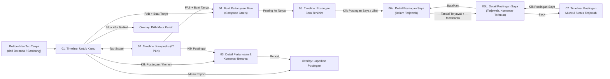

# Spesifikasi Fitur: Modul Utama 3 (Tanya / Forum Q&A Lintas Kampus ala X & Threads)

Dokumen ini adalah spesifikasi produk dan UX resmi untuk **Modul Utama 3 (`Tanya`)** pada proyek **Hoppa (UI/UX SEVENT X)**, tersinkronisasi penuh dengan [DESIGN.md](./DESIGN.md), [MODUL_1_BERANDA.md](./MODUL_1_BERANDA.md), dan [MODUL_2_SAMBUNG.md](./MODUL_2_SAMBUNG.md).

- **Proyek**: Hoppa (Mobile EdTech untuk Mahasiswa Indonesia)
- **Referensi Visual**: Halaman `Ide` (`image 18`: struktur detail thread & komentar berantai ala X/Threads dalam Light Mode Hoppa)
- **Identitas Pengguna**: **Non-Anonim (Nama Asli + Asal Kampus)** serta lencana reputasi kecil (contoh `#1 UI/UX`) khusus bagi Top Volunteer dari Modul 2.
- **Biaya**: **100% Gratis (0 Token)** untuk membuat pertanyaan, menjawab, dan melakukan **Boost**.

---

## 1. Tujuan & Nilai Utama Modul 3

Menyediakan ruang tanya jawab asinkron yang **ringan, cepat dipindai, dan akrab seperti timeline X/Threads**, khusus untuk diskusi materi kuliah antar-mahasiswa:
1. **Bertanya tanpa hambatan**: Mahasiswa cukup menulis judul, penjelasan singkat, memilih mata kuliah/topik, dan melampirkan foto soal atau cuplikan kode secara gratis (`0 Token`).
2. **Distribusi organik lewat `Boost` gratis 1-klik**: Siapa saja dapat menekan **`Boost`** agar pertanyaan penting naik ke timeline lebih banyak mahasiswa lintas kampus.
3. **Kredibilitas transparan**: Nama asli, asal kampus, dan lencana Volunteer (misal `#1 UI/UX`) menumbuhkan rasa percaya pada jawaban tertulis.
4. **Solusi cepat ditemukan**: Penanya dapat menandai jawaban paling tepat dengan status **`Jawaban Membantu`** (hijau lembut) sehingga pembaca lain langsung melihat solusinya.
5. **Ruang diskusi aman**: Setiap postingan dilengkapi menu **`Laporkan`** yang membuka `Report Violation Modal` reusable.

---

## 2. Alur Pengguna End-to-End

---

## 3. Spesifikasi Fungsional per Layar

### 3.1 `01. Tanya: Timeline (Untuk Kamu)` & `02. Tanya: Timeline (Kampusku IT PLN)`
- **Header Biru Melengkung khas Hoppa**: Judul putih **`Tanya`** di kiri + tombol pencarian putih transparan di kanan + sakelar 2 tab cakupan **`Untuk Kamu`** vs **`Kampusku (IT PLN)`**.
- **Bar Filter Mata Kuliah Skalabel**: Chip horizontal (`Semua`, `Basis Data`, `PBO`, `UI/UX`) + chip **`Lainnya ⌄`** yang membuka **`Overlay: Pilih Mata Kuliah (Tanya)`** berfitur pencarian 48+ mata kuliah.
- **Feed Editorial Bersih (Gaya X/Threads, Tanpa Pill Soup)**:
  - Identitas non-anonim (avatar inisial, **Nama Asli**, asal kampus, ikon pita kecil + teks ungu `#1 UI/UX` bila Top Volunteer, dan waktu posting).
  - Judul pertanyaan tebal, penjelasan singkat, hashtag mata kuliah inline (misal `#BasisData`, `#PBO`, `#UIUXDesign`), serta teks status inline **`✓ Terjawab`** (hijau gelap) bila sudah memiliki jawaban membantu.
  - Pratinjau media/kode gelap (`#1C2833`) bila ada lampiran, dengan daftar feed yang bisa digulir vertikal (`5-6` postingan per tab).
  - Bar aksi bawah ringkas: jumlah **`Jawaban`**, tombol interaktif **`Boost`** (1-klik menyala biru + angka naik), dan pintasan **`Laporkan`**.
- **Tombol Melayang (`+`)**: FAB bulat biru 3D taktil (`56x56px`) di kanan bawah di atas `Bottom Navigation` untuk menulis pertanyaan baru.

### 3.2 `03. Tanya: Detail Pertanyaan & Jawaban` (Mengacu `image 18`)
- **Top Bar**: Tombol **`Back` (`←`)**, judul **`Pertanyaan`**, dan tombol **`Report`**.
- **Postingan Utama**: Identitas lengkap penulis, tag topik, judul + deskripsi penuh, pratinjau kode/foto lampiran, metadata waktu & tayangan tanpa bullet-dot, serta bar aksi (`Jawaban`, `Boost`, `Laporkan`).
- **Kotak Balas Cepat**: Avatar pengguna + komponen interaktif **`Tanya Reply Composer`** (`Tulis jawaban kamu...` + tombol **`Balas`**).
- **Komentar Berantai Bergaris Vertikal**:
  - Jawaban utama menampilkan status hijau lembut **`Jawaban Membantu`**, lencana `#1 UI/UX` milik `Raka Permana`, dan tombol interaktif **`Tanya Helpful Vote Button`**.
  - Balasan lanjutan dari penanya terhubung lewat garis vertikal halus (`#CBD5E1`) persis struktur `image 18`.

### 3.3 `04. Tanya: Buat Pertanyaan Baru (Compose)` & `05. Timeline (Postingan Terkirim)`
- **Compose (`04`)**: Tombol `Batal`, label teks **`Gratis (0 Token)`**, identitas publik `Raka Permana (Institut Teknologi PLN)`, reusing komponen interaktif **`Question Composer Input`** (`692:3856`), **`Subject Picker Chip`** (`692:3894`), dan **`Attachment Picker Chip`** (`692:3941`), serta CTA biru 3D **`Posting ke Tanya (Gratis)`**.
- **Postingan Terkirim (`05`)**: Postingan baru Raka langsung tampil di posisi teratas timeline, ditemani **floating dark snackbar pill** ala iOS (`#1C2833`: ikon centang hijau + `Pertanyaanmu diposting` + tombol **`Lihat`** ke layar `06a`) yang melayang rapi di sisi kiri FAB `+` di atas `Bottom Navigation`.

### 3.4 `06a` & `06b` Detail Postingan Saya (Tandai Terjawab) + `07` Timeline Terjawab
- **Kontrol Khusus Pemilik (`06a. Belum Terjawab`)**: Di bawah bar aksi postingan milik sendiri tampil panel tipis **`Sudah paham dari jawaban di bawah?`** dengan tombol hijau **`Tandai Terjawab`** serta pintasan **`✓ Tandai membantu`** di setiap balasan. Mengetuk salah satunya langsung mengubah status via Smart Animate ke `06b`.
- **Status Terjawab Tetap Bisa Dikomen (`06b. Terjawab`)**: Muncul status inline hijau **`✓ Terjawab`** di samping `#PBO`, balasan terpilih mendapat label inline **`✓ Jawaban Membantu`**, panel pemilik berganti menjadi **`Ditandai terjawab`** (dengan keterangan **`Komentar tetap terbuka untuk semua`** dan tombol **`Batalkan`** untuk membuka kembali statusnya), serta **`Tanya Reply Composer`** tetap aktif terbuka agar mahasiswa lain tetap bisa berkomentar.
- **Refleksi di Timeline (`07. Timeline Postingan Terjawab`)**: Menekan tombol `Back` dari `06b` membawa pengguna kembali ke timeline dengan status **`✓ Terjawab`** dan jumlah jawaban terbaru langsung tampil pada postingan Raka.

---

## 4. Komponen Reusable Baru (`Komponen` `5:22`)
1. **`Tanya Boost Button`**: Toggle interaktif `Active=Off` <-> `Active=On` (biru lembut + angka bertambah `+1`) via `On Click` Smart Animate Spring.
2. **`Tanya Helpful Vote Button`**: Toggle suka/membantu `Active=Off` <-> `Active=On` (merah lembut + hati terisi + angka bertambah `+1`).
3. **`Tanya Reply Composer`**: Kolom balas cepat interaktif `State=Empty` <-> `State=Filled` untuk halaman detail thread `03`.
4. **Komponen Existing yang Dipakai Ulang**: `Bottom Navigation` (`Tab=Tanya`), `Button`, `Question Composer Input`, `Subject Picker Chip`, `Attachment Picker Chip`, `Report Violation Modal`, `iOS Status Bar`, dan `iOS Home Indicator`.
