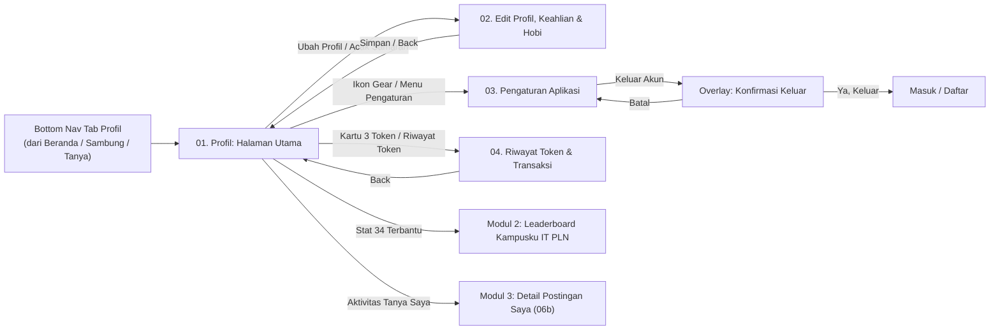

# Spesifikasi Fitur: Modul Utama 4 (Profil, Reputasi & Pengaturan)

Dokumen ini adalah spesifikasi produk dan UX resmi untuk **Modul Utama 4 (`Profil`)** pada proyek **Hoppa (UI/UX SEVENT X)**, tersinkronisasi penuh dengan [DESIGN.md](./DESIGN.md), [MODUL_1_BERANDA.md](./MODUL_1_BERANDA.md), [MODUL_2_SAMBUNG.md](./MODUL_2_SAMBUNG.md), dan [MODUL_3_TANYA.md](./MODUL_3_TANYA.md).

- **Proyek**: Hoppa (Mobile EdTech untuk Mahasiswa Indonesia)
- **Persona Utama**:
  - **Identitas Publik (`Tanya` & `Leaderboard`)**: **Raka Permana**, Sistem Informasi (Semester 4), Institut Teknologi PLN, `raka.permana@itpln.ac.id` (Terverifikasi), reputasi `#1 UI/UX` (`34 terbantu`, rating `4.9`).
  - **Identitas Anonim (`Sambung`)**: **`Buaya Cipondoh`** (dapat diacak/ganti kapan saja dari Profil).
  - **Keahlian Volunteer**: `UI/UX Design`, `Basis Data`, `Analisis & Perancangan Sistem`.
  - **Hobi Pencocokan**: `Formula 1`, `Sepak Bola`, `Marvel Cinematic`.
- **Navigasi**: `Bottom Navigation` (`Tab=Profil`, posisi terkunci `x: 24, y: 844`, transisi 1-klik `Smart Animate 0.25s Ease Out`).

---

## 1. Tujuan & Nilai Utama Modul 4

Menjadi pusat kendali identitas ganda, transparansi ekonomi token, aktivitas forum, dan pengaturan privasi yang 100% terhubung ke seluruh fitur Hoppa:
1. **Transparansi Identitas Ganda**: Pengguna melihat dengan jelas mana profil publik (`Raka Permana`) untuk `Tanya`/`Leaderboard` dan mana identitas anonim (`Buaya Cipondoh`) untuk panggilan suara `Sambung`.
2. **Kendali Keahlian & Hobi Pencocokan**: Mahasiswa dapat memperbarui daftar keahlian Volunteer serta hobi pencocokan (`Formula 1`, `Sepak Bola`, `Marvel Cinematic`) kapan saja setelah Onboarding.
3. **Audit Ekonomi Token yang Jujur**: Menampilkan saldo aktif (`3 Token`) beserta riwayat mutasi (`+1` bantu teman di Volunteer, `-1` sesi call Seeker, `0` di Tanya) agar keadilan sistem terasa nyata.
4. **Pengaturan Relevan Fitur Hoppa**: Pengaturan tidak generik; setiap toggle mengontrol fitur nyata seperti `Voice Changer Otomatis`, `Status Siap Volunteer`, `Pengingat Retensi Roadmap`, dan `Notifikasi Balasan Tanya`.

---

## 2. Alur Pengguna End-to-End

---

## 3. Spesifikasi Fungsional per Layar

### 3.1 `01. Profil: Halaman Utama` (`Tab=Profil`)
- **Header Biru Melengkung khas Hoppa (`#0277BD`)**: Judul putih **`Profil`** di kiri + tombol ikon gear putih transparan di kanan menuju `03. Pengaturan`.
- **Kartu Identitas Ganda (Melayang di atas kurva header)**:
  - Avatar inisial `RP`, nama **Raka Permana**, lencana inline ungu `#1 UI/UX`, subjudul `Sistem Informasi (Sem 4)`, `Institut Teknologi PLN`, dan status inline hijau **`✓ Email Kampus Terverifikasi`**.
  - Baris pemisah tipis ke **Identitas Anonim Sambung**: avatar maskot kecil + **`Buaya Cipondoh`** + tautan teks biru **`Ganti`** menuju `02. Edit Profil`.
- **Bar 3 Metrik Nyata Ekosistem Hoppa** (ringkas tanpa pill soup):
  - **`3 Token`** (klik -> `04. Riwayat Token`)
  - **`34 Terbantu`** (klik -> `13b. Leaderboard Kampusku IT PLN`)
  - **`12 Tanya`** (klik -> `06b. Detail Postingan Saya`)
- **Bagian Keahlian & Hobi** (kartu putih bersih dengan tombol teks **`Ubah`** -> `02`):
  - **Keahlian Volunteer**: `UI/UX Design`, `Basis Data`, `APS` (chip netral bersih, bukan pastel soup).
  - **Hobi Pencocokan**: `Formula 1`, `Sepak Bola`, `Marvel Cinematic`.
- **Daftar Menu Aktivitas & Pengaturan** (grouped iOS list):
  - `Riwayat Token & Transaksi` (`3 Token tersedia`) -> `04`
  - `Aktivitas Tanya Saya` (`1 pertanyaan terjawab, 14 jawaban membantu`) -> `06b`
  - `Pengaturan & Privasi` (`Voice changer, notifikasi, akun`) -> `03`

### 3.2 `02. Profil: Edit Profil, Keahlian & Hobi`
- **Top Bar**: Tombol `Back`, judul **`Edit Profil`**, dan tombol teks **`Simpan`**.
- **Identitas Anonim Sambung**: Kartu menampilkan **`Buaya Cipondoh`** dengan tombol **`Acak Nama`** (mengganti kombinasi hewan + lokasi khas Indonesia).
- **Info Akademik**: Field bersih untuk Nama Lengkap (`Raka Permana`), Program Studi (`Sistem Informasi`), Semester (`Semester 4`), dan Email Kampus terkunci (`raka.permana@itpln.ac.id`).
- **Keahlian Volunteer** (interaktif / terkurasi): `UI/UX Design`, `Basis Data`, `APS`, plus opsi `+ Tambah Keahlian` (misal `PBO`).
- **Minat & Hobi Pencocokan**: `Formula 1`, `Sepak Bola`, `Marvel Cinematic`, plus `+ Tambah Hobi`.

### 3.3 `03. Profil: Pengaturan`
- **Grup 1: Privasi & Call Sambung**
  - **`Voice Changer Otomatis`** (Switch ON): Aktifkan penyamar suara sejak detik pertama panggilan.
  - **`Siap Terima Panggilan Volunteer`** (Switch ON): Nonaktifkan sementara saat sedang ujian atau sibuk.
  - **`Keamanan & Riwayat Laporan`**: Deteksi pelanggaran real-time aktif (`0` pelanggaran).
- **Grup 2: Notifikasi**
  - **`Pengingat Retensi Roadmap`** (Switch ON): Jadwal pengulangan materi Modul 1.
  - **`Balasan & Boost di Tanya`** (Switch ON): Notifikasi jawaban baru dan boost postingan.
- **Grup 3: Akun & Bantuan**
  - **`Email Kampus`**: `raka.permana@itpln.ac.id` (`Terverifikasi`).
  - **`Ubah Kata Sandi`**
  - **`Pusat Bantuan & Pedoman Komunitas`**
- **Tombol Aksi Keluar**: Tombol teks/outlined merah bersih **`Keluar dari Akun`** yang membuka `Overlay: Konfirmasi Keluar`.

### 3.4 `04. Profil: Riwayat Token`
- **Hero Saldo Ringkas**: Kartu biru lembut/putih menampilkan **`3 Token Tersedia`**, keterangan singkat **`Bantu teman di Volunteer (+1 Token) • Forum Tanya selalu gratis (0 Token)`** (ditulis bersih dengan pemisah spasi/baris tanpa bullet-dot).
- **Daftar Mutasi Transparan**:
  - **`+1 Token`** (hijau): `Membantu Buaya Kemang (UI/UX Design)` · `Hari ini, 16.40`
  - **`-1 Token`** (merah lembut): `Call Sambung bersama Buaya Dago (PBO)` · `Hari ini, 14.12`
  - **`+3 Token`** (hijau): `Bonus Pendaftaran Akun Kampus IT PLN` · `20 Nov 2026`

### 3.5 `Overlay: Konfirmasi Keluar`
- Dark scrim (`#0F172A` 55%) + modal putih bersih (`cornerRadius: 24px`): judul **`Keluar dari Hoppa?`**, penjelasan singkat bahwa progres roadmap & saldo `3 Token` tetap tersimpan aman di akun kampus, tombol sekunder **`Batal`** (`CLOSE_OVERLAY`), dan tombol merah **`Ya, Keluar`** (mengarah ke layar **`Masuk / Daftar`**).
